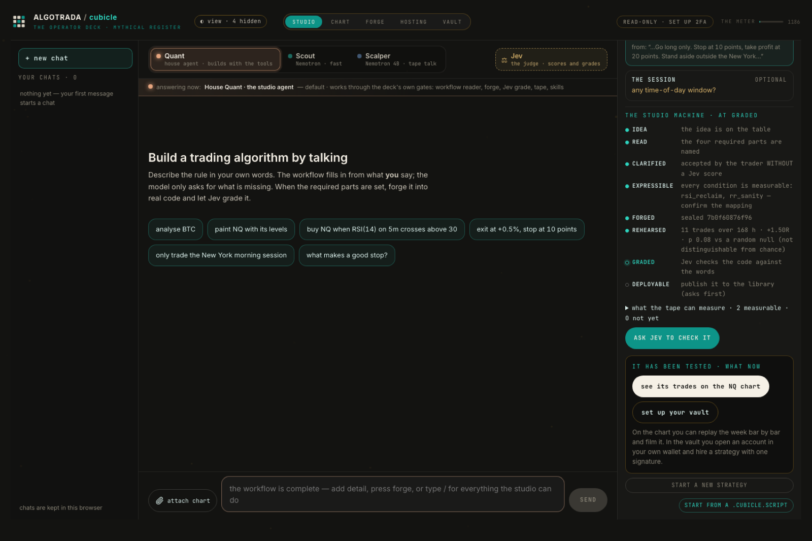

# 2026-10-12 · three public strategies, reverse-engineered, built and run on recorded bars

**Where:** production, `https://cubicle.algotrada.com/deck/api/mcp`, deck commit `ed40d39`.
**Who:** a brand-new free account minted by `cubicle join` minutes earlier. No plan, no house access.
**With:** this repo only (`cubicle_sdk/mcp.py`, `examples/reconstruct.py`), Python standard library.

## What was run

1. `cubicle join <name>`: a free key, saved 0600, never printed.
2. `cubicle reverse examples/strategies/opening-range-breakout.pine`: a Pine script read statically.
   Transcript: [opening-range-breakout.pine.txt](opening-range-breakout.pine.txt).
3. `python3 examples/reconstruct.py <rule> --market <M> --accept` for three textbook rules written in plain words.
   Transcripts: [opening-range-breakout.txt](opening-range-breakout.txt), [rsi2-pullback.txt](rsi2-pullback.txt),
   [bollinger-reversion.txt](bollinger-reversion.txt).

## What came back

| rule | market | checklist answered | forged | trades in 168 h | sum | the studio's gate |
|---|---|---|---|---|---|---|
| Opening range breakout | NQ | 7 of 9 | `a6631d6445f82a73…` | 5 | +2.5R | at least 10 trades are needed to judge it |
| RSI-2 pullback | ES | 7 of 9 | `930cfec91ea35e14…` | 4 | +1R | at least 10 trades are needed to judge it |
| Bollinger mean reversion | BTC | 7 of 9 | `b7decef109286099…` | 37 | +0.5R | not yet told apart from chance (p 0.33 to 0.38 over three runs) |

The two checklist lines left open before the run are the same for every rule in words: "do its numbers match
the tape" and "was it run over recorded bars". The rehearsal is what answers them.

The Pine script: 6 observed, 1 inferred, 4 unknown. It codes entries on both sides, a stop and a target, and a
session window; it names no market and no bar size (those are the chart's), and `calc_on_every_tick` is flagged
as a repaint risk. Nothing was run, and the dossier says so.

## What this shows, and what it does not

- The whole chain works for an outside agent with a free key: sign up, take a strategy apart, build it, run it
  on a week of real bars, in about a minute per rule.
- **No rule here is shown to work.** Two did not trade often enough in a week to judge; the third traded 37
  times and is not told apart from chance. That is the product doing its job.
- The forge built each machine from the gates the tape can measure (`choose_coverage: approximate`), so a
  forged machine can be an approximation of the words. The studio's grade (`grade`) is the check of the code
  against the words; it was not run here.
- The rehearsal window is the trailing 168 hours, so it moves with the market: at 15:14 CEST, after BTC fell, the
  same Bollinger machine read 37 trades, −2R, p 0.67. The two futures rules were unchanged (5 and 4 trades).
- A forge of the same words gives the same seed (`a6631d64…` twice): the build is deterministic. The p-value
  moves between runs because the random null is re-drawn.

## The same chain for a person

The studio at `https://cubicle.algotrada.com/deck` (screenshot from the 2026-10-09 production run on a QA
account): the rule in words on the left, the studio's state machine on the right (idea, read, clarified,
expressible, forged, rehearsed, graded), and the one next move as a button.
